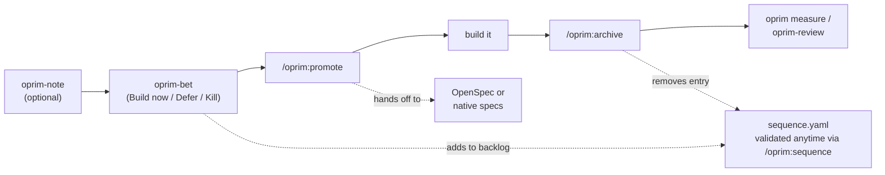

# Open Product Primer

Every developer hits the same moment: you're about to build something and haven't written down why — what problem it solves, why now, and what would make you stop. **`oprim`** gives that decision a home in your repo.

Install `oprim`, run `oprim init` to set up your workspace, then use `oprim-bet` in your AI coding agent to capture your first decision. That's the core loop.

## What it does

oprim stores the decisions that precede implementation — why you're building something, in what order, and whether it worked. It always answers **why / order / outcomes**, and can optionally also own **what / how** for each change, either alongside your implementation planning tool (OpenSpec) or on its own via native specs — plus a traceability layer (Graphify) if you use one:

| Layer | Tool | Artifacts |
|-------|------|-----------|
| Decision & sequencing | oprim | `oprim/` |
| Implementation planning | OpenSpec (`opsx`), or oprim's own native specs | `openspec/changes/`, or `oprim/specs/` |
| Semantic traceability | Graphify | `graphify-out/` |

Pick a spec framework at `oprim init` time (`openspec`, `native`, or `none`) — see [Native specs](#native-specs) below.

## The workflow



1. **Capture** an idea as a note (optional), or go straight to a **bet** — a committed decision with a why, alternatives, expected outcome, kill criterion, and a Build now/Defer/Kill call
2. Every bet lands in the sequencing board's backlog automatically; `/oprim:sequence` validates and rebalances the Now/Next/Later board at any point, not just here — run it whenever the board needs a health check
3. **Promote** (`/oprim:promote BET-XXX`) hands the bet to OpenSpec or native specs for the what/how — define success first with `oprim-criteria`
4. Build against that spec
5. **Archive** (`/oprim:archive BET-XXX`) folds any spec delta into current truth, closes the bet out, and removes it from the board
6. **Measure and review** (`oprim measure`, `oprim-review`) compare outcomes against the criteria set in step 3

See [`WORKFLOW.md`](WORKFLOW.md) for the full walkthrough of each stage, what artifact it produces, and what happens if you skip it.

## Installation

```bash
npm install -g @open-product-primer/cli@latest
```

## Quick start

```bash
cd your-project
oprim init    # scaffold oprim/ workspace
oprim doctor  # verify setup
oprim update  # install /oprim:* assistant commands
```

Want to try oprim before setting it up on your own project? Clone this repo and open [`examples/`](examples/) — a ready-to-use `oprim/` workspace for a mock todo app, no `oprim init` required. Open it in Claude Code and run the `oprim-tutorial` skill for a guided walk through the full bet → spec → archive cycle.

## CLI reference

### `oprim init`

Creates the project-local `oprim/` workspace. Idempotent — safe to re-run; existing decision artifacts and config values are preserved. Existing repos with `primer/` should run `oprim migrate` first.

Prompts interactively for: [OKF](https://github.com/GoogleCloudPlatform/okf) (Open Knowledge Format) frontmatter — whether scaffolded artifacts get `oprim`-schema YAML frontmatter, so other tools can parse them as structured metadata instead of plain prose — a spec framework (`openspec`, `native`, or `none`), and which AI agents to install skills for (`claude`, `cursor`, `codex`, `gemini`, `poolside`, `vibe` — repeatable via `--agent`, or `--name <project-name>` to override the default directory-name project name).

**Creates:**

```
oprim/
├── config.yaml           # project config, integration flags, spec framework, rules
├── sequence.yaml         # Now/Next/Later board
├── decisions/            # PDR artifacts
├── bets/                 # bet decision artifacts
├── reviews/               # KPI review artifacts
├── notes/                 # lightweight capture artifacts (precede a bet)
├── scripts/
│   └── generate-sequence-view.js
└── templates/             # ready-to-use templates
    ├── pdr.md
    ├── bet-decision.md
    ├── criteria.yaml
    ├── kpi-review.md
    ├── discovery.md
    └── note.md
```

Detects OpenSpec (`openspec/`) and Graphify (`graphify-out/`) and enables integration flags in `oprim/config.yaml` without requiring those tools to be present.

`oprim/config.yaml` also carries a free-text `context:` block (language, tech stack, project conventions), per-artifact `rules:` (`bet`/`pdr`/`spec`/`review` — custom instructions folded into bet/PDR/spec/review generation prompts when set), and a `remote_context:` block (`enabled`, `sources: []`) for citing other projects' oprim workspaces — see `oprim context` below. All default to empty/inert and don't change generation behavior until set.

#### Portfolio mode — `oprim init --mode portfolio`

A **portfolio workspace** is a PM's own oprim repo spanning several products: company-wide context, objectives and cross-product ordering, while each product keeps its own oprim instance. See [PDR-001](oprim/decisions/PDR-001-separate-portfolio-and-product-authority.md) for the authority split. `--mode portfolio` writes `mode: portfolio` and `integrations.spec_framework: none` (no framework prompt — a portfolio never holds specs), creates everything product mode creates, and adds:

```
oprim/
├── handbook/             # overview.md, principles.md, glossary.md — human-written, citable by products
└── objectives/           # OKRs — OBJ-NNN-<slug>.md, written by oprim-objective, citable by products
STATE.md                  # personal working state — never exported
inbox.md                  # capture-first inbox — never exported
wiki/                     # append-only knowledge: log.md, people/, products/, decisions/
outputs/                  # comms drafts and handoffs
```

Everything under `oprim/` is citable by products through remote context; the root personal files are outside `oprim/`, so they are never exported, and the CLI never parses them. Re-running init never overwrites any of these files, and a plain `oprim init` re-run keeps the workspace's existing mode. Converting an existing workspace between modes is not supported. A config with no `mode:` key is a product workspace — nothing is ever added to existing product configs.

`oprim doctor` / `oprim validate` report an unknown `mode:` value as a required failure; in portfolio mode they also require `spec_framework: none` and no `specs/` under pending bets, and warn (non-required) when a personal file is missing.

Products are linked by naming an existing `remote_context` source — never with their own `git`/`path` (one linking mechanism, PDR-001):

```yaml
remote_context:
  enabled: true
  sources:
    - name: checkout
      git: git@github.com:acme/checkout.git
products:
  - source: checkout        # must be a remote_context.sources name
    owner: Dana             # optional metadata — owner, squad, objectives, status
    squad: payments
    status: active          # active | paused | sunset (default active)
```

In portfolio mode `doctor`/`validate` report a `products:` entry whose `source` is not registered, or that carries its own `git`/`path`, as a required failure.

#### Objectives (OKRs)

Objectives are first-class portfolio artifacts at `oprim/objectives/OBJ-NNN-<slug>.md`, written by the portfolio-only `oprim-objective` workflow (template: `oprim/templates/objective.md`):

```markdown
# OBJ-002: Grow repeat purchases

## Status
Active                    # Active | Achieved | Dropped | Superseded by OBJ-MMM

## Period
2027-Q1

## Key results
- Repeat-purchase rate: 18% → 25% by end of quarter

## Rationale
Why this objective, why this period.
```

With OKF frontmatter enabled the file also carries `type: objective`, `period` and `status` in its frontmatter. Bets link objectives in their `## Links` section — unqualified in the portfolio itself, qualified from a product — and a `products:` entry's `objectives:` takes the same references:

```markdown
## Links
- PDRs: PDR-001
- Objectives: OBJ-001, acme-portfolio:OBJ-002
```

`oprim-bet` asks for objectives (and writes the `- Objectives:` line) only in a portfolio workspace or a product with a registered portfolio source. `oprim doctor` / `oprim validate` then report:

| Situation | Result |
|---|---|
| unqualified `OBJ-NNN` that does not exist (bet Links or `products[].objectives`) | required failure |
| qualified `<source>:OBJ-NNN` that does not exist | required failure (cross-product reference check — reported once) |
| pending bet with no objective link, in a portfolio or a product with a portfolio source | non-required warning |
| pending bet with no objective link, in a product with no portfolio source | nothing |
| bet linked only to `Achieved` / `Dropped` / `Superseded` objectives | non-required warning naming them |

#### Delegating a bet to a product (portfolio mode only)

`/oprim:delegate BET-NNN --to <product>` turns a portfolio bet into a product team's bet without copying it. The two bets are linked both ways and then evolve independently:

```markdown
# portfolio oprim/bets/pending/BET-004-…/bet-decision.md
## Links
- Delegated to: checkout:BET-031

# checkout oprim/bets/pending/BET-031-…/bet-decision.md
## Links
- Objectives: acme-portfolio:OBJ-002
- Delegated from: acme-portfolio:BET-004
```

The product bet is drafted from the portfolio bet (title, why now, outcomes, kill criteria, objectives qualified to the portfolio); owner, review date, decision and risks are asked fresh because the product owns them. The `Delegated from` qualifier is whatever name the *product* registered the portfolio under.

- **Local products** (`path:` source): the full bet, its target path and the backlog entry are shown first, and nothing is written to the product until you confirm. Then the bet is created with the product's next free `BET-NNN`, appended to its `sequence.yaml` backlog, and the portfolio bet gets its `Delegated to` line. The product team reviews and commits it.
- **Git products** (`git:` source): oprim writes `outputs/handoffs/<product>-BET-NNN.md` (a note to the owner, the ready-to-paste bet, the backlog entry) and records `- Delegated to: <product>:pending-handoff`. Once the team has created the bet, `/oprim:delegate BET-NNN --to <product> --link BET-MMM` replaces the placeholder.

**Never-push guarantee:** delegation never writes under the remote-context cache, never creates commits or branches, and never pushes — in any repository.

The portfolio never stores the delegated bet's status: `oprim ovw --portfolio` lists each delegation with the product bet's live lane (or `archived`) and `Decision`. In portfolio mode `doctor`/`validate` check every pair:

| Situation | Result |
|---|---|
| `Delegated to: <product>:BET-MMM` with a matching `Delegated from` back-link | pass |
| `<product>:pending-handoff` | pass, annotated `pending handoff` |
| product bet missing, back-link missing, or back-link naming another bet | required failure |
| product bet says `Delegated from` a portfolio bet that doesn't list it back | required failure |
| handoff applied by the product but still `pending-handoff` in the portfolio | non-required — run `--link` |
| product unreachable | non-required |

#### The PM daily loop (portfolio mode only)

Five workflows are installed only in a portfolio workspace, for every agent. They work with zero linked products and need no calendar or chat integration — if such tools are available in the session they are used, otherwise they are skipped silently.

| Step | Workflow | What it does |
|---|---|---|
| Capture | `oprim-capture "<text>"` | Appends `- [ ] <YYYY-MM-DD HH:MM> <text>` to `inbox.md`. No questions, no routing. |
| Triage | `/oprim:triage` | One question per open inbox item: NOTE in a product, portfolio NOTE, personal task (`STATE.md`) or discard. Local products are written only after you confirm the target path; git products get a handoff in `outputs/handoffs/`. Routed lines become `- [x] … → checkout:NOTE-012`. |
| Ingest | `/oprim:ingest <meeting note>` | Appends dated entries to `wiki/log.md`, `wiki/people/`, `wiki/products/`, `wiki/decisions/` (append-only), then proposes one destination per decision; nothing outside `wiki/` without confirmation, nothing in a product without a second one. |
| Start day | `/oprim:start-day` | A one-screen day plan from `STATE.md`, open inbox items and the boards (`oprim ovw --portfolio --json`, falling back to `oprim/sequence.yaml`). |
| Plan week | `/oprim:plan-week` | Asks "what has to be true by Friday?" and lays out the week. |

`start-day` and `plan-week` maintain four sections of `STATE.md`: `Focus`, `In progress`, `Blockers` and `Last commands` (an append-only log of PM workflow runs).

**Ask first.** In portfolio mode `oprim-bet`, `oprim-pdr` and `oprim-criteria` ask 2–3 questions about the assumptions a draft rests on before drafting it. Turn it off per workflow, or on in a product workspace, with a map-shaped rule (string rules keep working as plain guidance):

```yaml
rules:
  bet: "Always link an objective"   # string: custom guidance only
  pdr:
    text: "Cite evidence"           # map: guidance + ask_first toggle
    ask_first: false
```

Product-mode installs are byte-identical unless a product sets `ask_first: true`.

#### Prioritization, comms and reviewer personas (portfolio mode only)

Four more workflows turn the boards into proposals and drafts. None of them changes a board or sends anything: outputs land in `outputs/` (personal, never exported through remote context) for you to edit and act on.

| Workflow | What it does |
|---|---|
| `/oprim:prioritize` | Ranks pending bets across the portfolio and its products by objective fit (Active objectives only), risk profile and door type, showing those inputs per bet with a one-line rationale. Outputs a proposed `diff` for the portfolio `sequence.yaml` and suggestions addressed to product owners — it never writes any `sequence.yaml`. |
| `/oprim:stakeholder-update` | Asks audience (exec / eng / sales / customers) and period, reads the boards, objectives, KPI reviews and bet decisions, and writes `outputs/<period-end>-stakeholder-update-<audience>.md`. |
| `/oprim:roadmap-comms` | Same inputs, a now / next / exploring roadmap at `outputs/<period-end>-roadmap-comms-<audience>.md`. |
| `/oprim:publish <ref>` | Renders a Notion-compatible PRD from a local or qualified bet or PDR (decision, `criteria.yaml`, specs) to `outputs/publish/<ref>.md`, headed "Source of truth: `<ref>` in git". Uploads to Notion only when you explicitly ask and a Notion tool is available; never reads back. |

Comms drafts start with `> DRAFT — verify before sending.`, cite every bet as `<source>:BET-NNN`, write `[TBD — confirm with <owner>]` instead of inventing a commitment, and ask about the audience first (the `ask_first` rule above applies: `rules.stakeholder-update` / `rules.roadmap-comms`).

**Reviewer personas (Claude only).** A portfolio install with Claude also writes three subagents to `.claude/agents/`:

| Agent | Reviews |
|---|---|
| `c-level` | a bet decision — strategic fit, opportunity cost, risk |
| `eng-lead` | a bet's spec deltas or `design.md` — testability, scope, hidden complexity |
| `data-eng` | a bet's `criteria.yaml` (or its decision) — measurability, events/tables, baselines |

Ask Claude to "have the c-level agent review BET-004". Each persona appends one dated `## <persona> perspective` section and never edits existing content; re-reviewing appends a new section. In `criteria.yaml` the data-eng review is written as `# ` comment lines so the file parses to the same data and `oprim measure` keeps working. Fork a persona like any workflow with `oprim/workflows/persona-<name>.template.md`.

### `oprim update`

Refreshes `/oprim:*` assistant commands for detected AI tools (Claude Code, Cursor, Codex, Gemini, Poolside, Mistral Vibe). Also additively merges any `oprim/config.yaml` schema keys introduced since the project was last updated — adding missing keys with their defaults, never touching values you've already set.

### `oprim doctor`

Reports pass/fail status for:

- oprim/ scaffold and config
- OpenSpec and Graphify integrations (optional)
- measurement environment variables (`AMPLITUDE_API_KEY`, `GOOGLE_APPLICATION_CREDENTIALS`)
- bets missing `discovery.md`
- sequencing-board integrity (WIP limit overruns, dangling `blocked_by`/`unlocks` references; qualified `<source>:<ID>` entries are left to the cross-product check)
- cross-product `<source>:<ID>` references (see *Cross-product references* below)
- installed Claude skills that have drifted from the bundled versions (run `oprim update` to refresh)
- registered `remote_context` sources (reachable, identity resolves, name matches)
- installed assistant commands and hooks

### `oprim migrate`

Renames a legacy `primer/` directory to `oprim/` in place. Run this once before `oprim init` if the project predates the `oprim` rename; a no-op if `oprim/` already exists.

### `oprim measure <bet-id>`

Generates and runs KPI measurements for a bet from its `criteria.yaml`: writes Amplitude event definitions and BigQuery SQL to `oprim/bets/pending/BET-XXX/measurements/`, then executes them (requires `AMPLITUDE_API_KEY` / `GOOGLE_APPLICATION_CREDENTIALS` as applicable) and records a dated run result. Use `--dry-run` to generate the definition files without calling either API.

### `oprim ovw`

Prints the sequencing board (`now`/`next`/`later`/`backlog`) with each `now`/`next` bet annotated inline with its door type (1-way/2-way) and risk profile (value/usability/feasibility/viability), read from `bet-decision.md`. Follows with an advisory section flagging things like an empty or overloaded `now` lane, a 1-way door bet with no 2-way door "unrisker" in flight, doors sequenced in the wrong order, or elevated risk without a mitigation plan.

#### `oprim ovw --portfolio` (portfolio mode only)

One deterministic view across every product, read from files through remote context (no agent involvement):

```bash
oprim ovw --portfolio           # per-workspace Now/Next with load (e.g. "checkout now 2/2"), then problem sections
oprim ovw --portfolio --json    # the same view model as JSON (products, dependencies, delegations, coverage, hygiene)
oprim ovw --portfolio --write   # write oprim/portfolio-view.md (OKF frontmatter lists when okf.enabled, plain tables otherwise)
```

- **Boards** — the portfolio's own Now/Next, then each non-sunset `products:` entry with owner/squad and Now load against its `wip_limits.now`. A git source served from cache is marked `(stale)`; one with no cache is listed as `unreachable` instead of aborting.
- **Dependencies** — qualified `blocked_by` entries that don't resolve, or that are out of order (blocked bet in Now, blocker in Later/Backlog or off its board and not archived).
- **Delegations** — each portfolio bet's `Delegated to` targets with the product bet's live lane/`archived` state and `Decision`, or `pending handoff`.
- **Coverage** — active objectives with no Now/Next bet anywhere (directly, or via a `Delegated to`/`Delegated from` link), and Now/Next bets linked to no objective.
- **Hygiene** — pending bets whose `Review date` has passed, and promoted bets missing `criteria.yaml`.

In portfolio mode `doctor`/`validate` also warn (non-required) when a product's Now exceeds its own `wip_limits.now`, or when total Now across the portfolio and its products exceeds `wip_limits.portfolio_now` in the portfolio's `sequence.yaml`.

### `oprim context`

Manage citable connections between oprim workspaces across repositories:

| Subcommand | Description |
|---|---|
| `oprim context init [--description <text>]` | Declare the current project as a citable remote context — writes `.oprim-context/context.yaml` |
| `oprim context register --name <name> (--git <url> \| --local <path>) [--description <text>]` | Register another project's context as a source in this project's `oprim/config.yaml` |
| `oprim context list` | List registered sources with their canonical identity/description, without pulling full content |
| `oprim context [--source <name>]` | Print the fully resolved `oprim/` workspace content of every registered source (or just one) |

Git sources are cloned into a throttled local cache (`~/.oprim/remote-context-cache/`); local-path sources are always read live. `oprim doctor` validates that every registered source still resolves.

## Key concepts

### Product Decision Records (PDRs)

Durable product policy decisions stored at `oprim/decisions/PDR-XXX-name.md`. Separate from bet prioritization decisions so policy is never duplicated across initiative artifacts.

### Bet decisions

Say you're deciding whether to rewrite a legacy service, cut a feature that isn't landing, or invest in a new capability. Before you build, you write a *bet*: what's the problem, why tackle it now, and what outcome would tell you it worked. That artifact lives at `oprim/bets/pending/BET-XXX/bet-decision.md` and links to relevant policy decisions (PDRs) so you're not restating policy each time. A bet's directory sits under `oprim/bets/pending/` while active and moves to `oprim/bets/archived/` once folded into current truth — an at-a-glance built-vs-in-flight signal with no file inspection required.

### Sequencing board

`oprim/sequence.yaml` — structured Now/Next/Later board with `blocked_by`, `unlocks`, `requires_pdrs`, and WIP limits. Use `/oprim:sequence` to validate the board state.

### Criteria contracts

`oprim/bets/pending/BET-XXX/criteria.yaml` — metric definitions with baseline, target, timeframe, and data source. Imported from Notion at bet promotion time and linked forward to OpenSpec changes.

### KPI reviews

`oprim/reviews/YYYY-MM-DD-BET-XXX-kpi.md` — post-launch metric comparison and decision-quality reflection. Outcomes feed back into bet decisions, PDRs, and sequencing.

### Notes

`oprim/notes/` — lightweight, low-friction capture for an idea before it's worth writing up as a full bet. Promote a note into a bet once it's worth prioritizing.

### Native specs

An opt-in alternative (or complement) to OpenSpec, chosen at `oprim init` time (`integrations.spec_framework: native`). Current truth for a capability lives at `oprim/specs/<capability>/spec.md`, written in Gherkin; an in-flight bet's proposed ADDED/MODIFIED/REMOVED delta lives at `oprim/bets/pending/BET-XXX/specs/<capability>/spec.md` until `/oprim:archive` folds it into current truth. The first `oprim-spec` pass for a bet also scaffolds `design.md` (technical approach) and `tasks.md` (a flat, checkbox implementation list matching OpenSpec's own convention) alongside the spec delta; later passes for the same bet only touch the spec delta. A `tasks.md` with unchecked items makes `/oprim:archive` warn before archiving, so implementation completeness is visible without asking.

### Remote context

Lets one project cite another project's `oprim/` workspace as read-only context — for example, a service repo citing a platform repo's PDRs. The cited project runs `oprim context init` once to become citable; the citing project runs `oprim context register` to add it as a source. See `oprim context` above.

A portfolio workspace's `oprim context init` also writes `mode: portfolio` into its identity, and `oprim context list` labels such sources `portfolio`.

### Cross-product references

Any oprim artifact in a registered source can be cited as `<source>:<ID>`, where `<source>` is a `remote_context.sources` name and `<ID>` is `BET-NNN`, `PDR-NNN`, `OBJ-NNN` or `NOTE-NNN` — e.g. `checkout:BET-012`, `acme-portfolio:PDR-003`. An unqualified ID always means the current workspace. Write it **without a space** after the colon: `[checkout:BET-012]` is a string in YAML, `[checkout: BET-012]` is a map (doctor warns about that).

Qualified references are recognised, in both product and portfolio mode, in `sequence.yaml` (`blocked_by`, `unlocks`, `requires_pdrs`) and in a pending bet's `## Links` lines (`PDRs`, `Objectives`, `Delegated to`, `Delegated from`, `Cross-product`). `oprim doctor` / `oprim validate` resolve each one through remote context — each source is fetched at most once per run — and report the artifact's live state (bets `pending`/`archived`, PDRs/objectives their `## Status`). Nothing is copied into the citing repo.

| Outcome | Result |
|---|---|
| unknown qualifier | required failure |
| source reachable, artifact missing | required failure |
| source unreachable, no cache | non-required failure |
| source unreachable, served from last-known-good cache | pass, annotated `(stale)` |

## Agent commands

Install with `oprim update`, then use in Claude Code, Cursor, Codex, Gemini, Poolside, or Mistral Vibe:

| Command | Description |
|---------|-------------|
| `/oprim:promote BET-XXX` | Promote a prioritized bet to an OpenSpec (or native spec) change with criteria linking |
| `/oprim:sequence` | Validate the sequencing board and suggest rebalancing |
| `/oprim:archive` | Archive a completed bet — move it out of the active board |
| `/oprim:context-init` | Guided Q&A to declare the current project a citable remote context |
| `/oprim:explore` | Investigate a problem and compare candidate framings before a bet is drafted (read-only, hands off to `/oprim:bet`) |
| `/oprim:reconcile` | Detect and fix drift across linked PDR/bet/criteria/review artifacts, one confirmed fix at a time |
| `oprim-bet` | Create a new bet directory and bet-decision artifact, added to the sequencing backlog |
| `oprim-pdr` | Create a new Product Decision Record with an auto-assigned ID |
| `oprim-note` | Capture a lightweight note ahead of a full bet |
| `oprim-criteria` | Create or append to a bet's `criteria.yaml` metric contract |
| `oprim-review` | Create a KPI review artifact for a completed bet, pre-filled from `criteria.yaml` |
| `oprim-objective` | Portfolio mode only — create an objective (OKR) with an auto-assigned `OBJ-NNN` ID, or supersede one |
| `/oprim:delegate BET-NNN --to <product>` | Portfolio mode only — delegate a bet to a product with two-way links (confirmed write for local products, handoff file for git products; never pushes) |

## Authority boundaries

Open Product Primer owns **why / order / outcomes**.
**What / how** for each change is owned by OpenSpec, or by oprim's own native specs if that framework is selected — never both.

Primer artifacts never duplicate implementation requirements.
Spec artifacts (OpenSpec or native) never duplicate prioritization rationale.
The link between the layers is the promotion contract (`/oprim:promote`).

## npm package

Package: `@open-product-primer/cli`
Bin aliases: `oprim`, `open-product-primer`
Source: `packages/cli/`

Releases are published via GitHub Actions on `v*` tags using [npm trusted publishing](https://docs.npmjs.com/trusted-publishers/) (see `.github/workflows/release.yml`).
